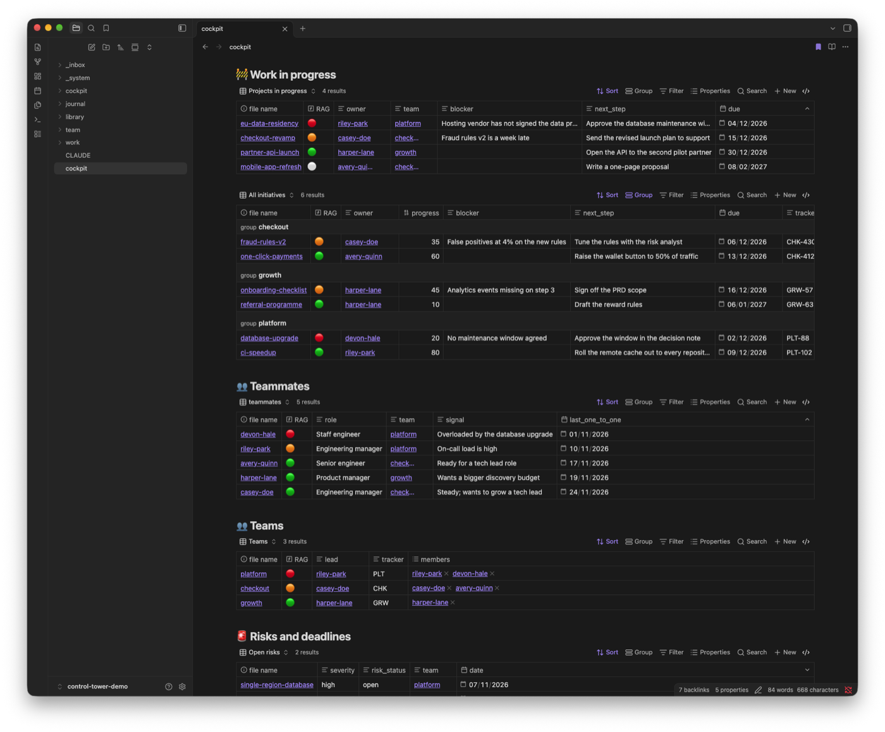
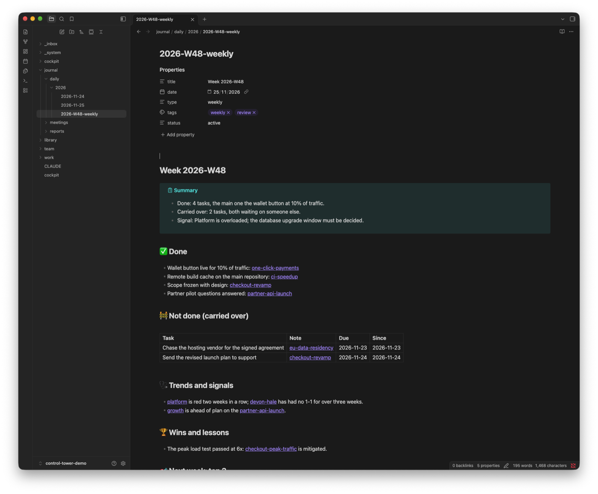

# Control Tower

A personal **control tower** for knowledge work: an [Obsidian](https://obsidian.md) vault, a set of [Claude Code](https://claude.com/claude-code) skills and optional scheduled jobs that keep your work, your team and your priorities in one place, without opening five tools every morning.

It is built for people who lead, build, plan or promote things: engineering leaders, developers, product managers, marketers. You pick the profiles (called **packs**) and the tools you already use (called **adapters**); an assistant installs everything for you.


## What you get

| Piece | What it does |
|---|---|
| **A structured vault** | A cockpit page, projects, workstreams, decisions, risks, people, meetings and reports, all as plain Markdown with typed properties and ready-made Obsidian dashboards. |
| **Skills** | Commands such as `/today`, `/inbox`, `/weekly-review`, `/meeting`, `/research`, plus pack skills (standup, campaign brief, PRD draft, postmortem...). |
| **Scheduled jobs** | Read-only reports written into the vault each morning or week (pull requests, error triage, campaign metrics, product digest...). |
| **Cloud routines** | Scheduled claude.ai routines; the installer offers them and creates the ones you choose. |
| **Tool adapters** | Documented, read-only connections to Jira, Linear, GitHub, Sentry, Rollbar, SonarQube, CloudWatch, Datadog, Google Calendar, Google Analytics, Amplitude, HubSpot, Asana. |
| **A guided installer** | Claude asks a few questions, then installs only what you chose. Nothing is overwritten. |

## A look inside

Screenshots of the fictional demo vault (company "Acme"), built with `python3 examples/build_demo_vault.py --out ~/control-tower-demo`.

| Projects, initiatives, people and teams at a glance | A weekly review written from your tasks |
|---|---|
|  |  |

| A 1-1 note filed by `/meeting`: decisions and actions routed to their notes |
|---|
|  |

## Design principles

1. **One task lives once.** Tasks are Markdown checkboxes in the note of their project or area, managed by the Obsidian Tasks plugin.
2. **Automations propose, you decide.** Anything a job suggests carries `#to-triage` until you accept it.
3. **Properties, not folders.** Status, owner and risk are note properties that dashboards query.
4. **Nothing is deleted.** Old material is archived.
5. **Read-only outside the vault.** Jobs never write to your external tools, only to the vault.

## Quick start

Prerequisites: Python 3.9+, git, [Claude Code](https://claude.com/claude-code), Obsidian 1.9 or newer. See [docs/getting-started.md](docs/getting-started.md) for details, including a short guide if you are new to the terminal.

```bash
git clone https://github.com/aouicher/control-tower-agentic.git
cd control-tower-agentic
claude
```

Then type `/install-control-tower` and answer the questions. Prefer a terminal wizard?

```bash
python3 installer/install.py --interactive
```

Or script it with an answers file (see [examples/answers](examples/answers)):

```bash
python3 installer/install.py --answers examples/answers/developer.json --dry-run
python3 installer/install.py --answers examples/answers/developer.json
python3 installer/doctor.py --vault ~/control-tower-developer   # the vault_path of the answers file
```

## Documentation

- [Getting started](docs/getting-started.md): prerequisites, install, first run, uninstall
- [Using it every day](docs/daily-use.md): morning, inbox, during the day, Friday, with examples per profile
- [Concepts](docs/concepts.md): vault layout, note types, tasks, page style
- [Packs](docs/packs.md): what each profile installs
- [Adapters](docs/adapters.md): connecting your tools, read-only
- [Scheduling](docs/scheduling.md): local jobs and cloud routines
- [Security and privacy](docs/security.md): what jobs can and cannot do
- [Troubleshooting](docs/troubleshooting.md)
- [Testing](docs/testing.md): unit, end-to-end and clean-container tests
- Design specs for contributors: [core](docs/design/core-spec.md), [packs](docs/design/pack-spec.md)
- [Contributing](CONTRIBUTING.md), [Changelog](CHANGELOG.md), [Security policy](SECURITY.md)

## Repository layout

```
core/        neutral vault shared by every pack
packs/       one folder per profile: vault overlay, vocabulary, jobs, routines
adapters/    one contract per capability, one note and manifest per tool
installer/   install.py, doctor.py, uninstall.py, render.py
scheduler/   run_job.py (job runner) and guard.py (safety hook)
examples/    answers files and a fictional "Acme" sample
tests/       standard-library unit tests
tools/       scan-leaks.py (secret and language scanner)
```

## Status

Version 0.1.0. Adapters marked `documented` in their manifest follow the tool's published documentation but have not been verified against a live account. Reports welcome.

## License

[MIT](LICENSE)
