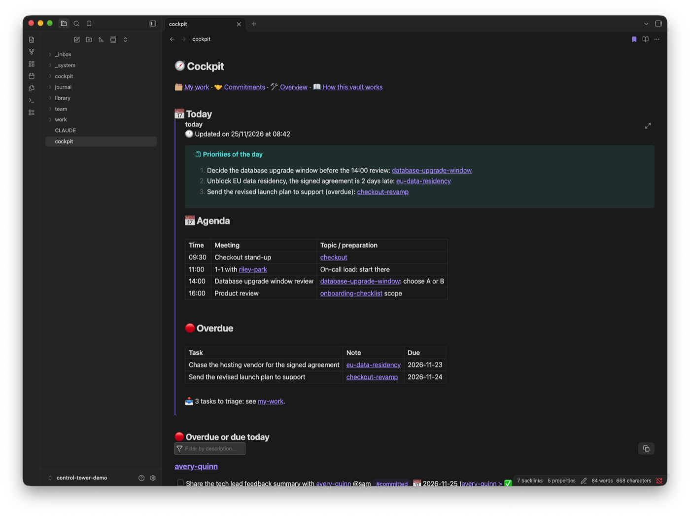
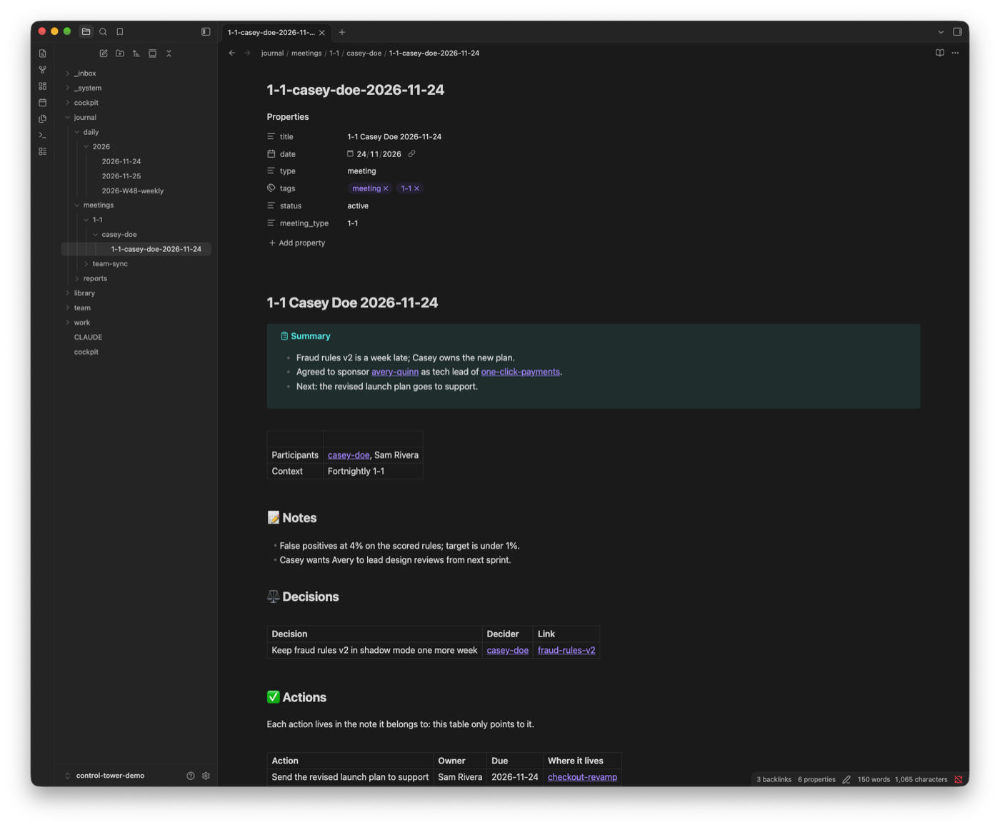

# Control Tower

A personal **control tower** for knowledge work: an [Obsidian](https://obsidian.md) vault, a set of [Claude](https://claude.com/download) skills and optional scheduled reports that keep your work, your team and your priorities in one place, without opening five tools every morning.

It is built for people who lead, build, plan or promote things: engineering leaders, developers, product managers, marketers. You pick the profiles that fit your work and name the tools you already use; Claude installs everything for you, by asking questions. You never type a command.

This page has two parts: **[Use Control Tower](#part-1-use-control-tower)**, for everyone, and **[Develop the kit](#part-2-develop-the-kit)**, for people who work on this repository.



# Part 1: Use Control Tower

## What you need

- A Mac (Linux works too; Windows is not supported yet).
- The [Claude desktop app](https://claude.com/download), signed in.
- [Obsidian](https://obsidian.md/download) 1.9 or newer, to read and write your notes.

If your Mac asks to install developer tools during the install (Python or git), click Install.

## 1. Install it in one sentence

In the Claude desktop app, open the **Code** tab, choose any folder (your home folder is fine) and paste:

> Install the Control Tower kit from https://github.com/aouicher/control-tower-agentic into ~/control-tower-kit and follow its install skill.

Claude asks before downloading the kit. Then it asks:

1. the language of your notes and reports (the rest of the install continues in it; the vault's templates, section titles and folder names stay in English);
2. which describes your work: engineering leader, developer, marketing, product (one or more);
3. which tools you use at work: tick them in a list, and type any other;
4. where the vault goes: keep the default, **control-tower-vault** in your home folder (on a Mac, a vault inside iCloud Drive, Documents or Desktop may be blocked for scheduled reports by the privacy rules, which then fail without a window to ask you);
5. whether reports run on their own, at the usual times.

It then shows what it will install (each report, when it runs and what it may read) and installs after your yes. Nothing is overwritten, and it never asks for a password or a key.

When it is done, you have three folders in your home folder:

| Folder | What it is |
|---|---|
| `control-tower-vault` | **Your notes.** This is the folder you open in Obsidian and in Claude. |
| `control-tower-kit` | The kit itself. You never need to open it. |
| `.control-tower` (hidden) | What runs your reports: their settings and logs. |

## 2. Open your vault in Obsidian

1. Open Obsidian. If it opens on another vault, click the vault name at the bottom left, then **Manage vaults**.
2. Choose **Open folder as vault**, select **control-tower-vault** in your home folder, then **Open**.
3. Turn on the **Tasks** plugin, which the dashboards need: **Settings** (gear icon, bottom left), **Community plugins**, **Turn on community plugins**, **Browse**, search "Tasks", **Install**, then **Enable**.
4. Open **cockpit** in the file list: it is your home page.

Obsidian keeps the vault in its list: next time it opens there directly.

## 3. Talk to your control tower

Everything else happens in a Claude session on your vault: the control tower's commands exist only there, not in the session that installed it. At the end of the install, Claude offers to open that session for you; otherwise, in the Claude app, start a new **Code** session and choose the folder **control-tower-vault** (it stays in your recent folders). Say **hello control tower**, then, in your own words:

| You say | Claude |
|---|---|
| "connect Amplitude" (or any tool you named) | adds the connection to your vault and has you sign in in your browser when the tool allows it, or tells you who sets it up (a tool that needs a key); then the reports that need it can read it |
| "every Monday, sum up my tickets" | writes a report of your own, tries it with you, and schedules it |
| "move the triage to 9:00", "stop the debt review", "add the product profile", "write my notes in Deutsch" | changes your setup after showing you what changes |
| "fix my job" (when a notification says a report was blocked) | explains what the report was refused and asks whether to allow it |
| "check my setup" | says what is installed, what runs when, and what needs your attention |
| "update the kit", "uninstall" | updates or removes the kit; your notes are never removed |

Day-to-day commands such as `/today`, `/inbox`, `/weekly-review` and `/meeting` are described in [Using it every day](docs/daily-use.md).

## What you get

| Piece | What it does |
|---|---|
| **A structured vault** | A cockpit page, projects, workstreams, decisions, risks, people, meetings and reports, all as plain Markdown with typed properties and ready-made Obsidian dashboards. |
| **Skills** | Commands such as `/today`, `/inbox`, `/weekly-review`, `/meeting`, `/research`, plus profile skills (standup, campaign brief, PRD draft, postmortem...). |
| **Scheduled reports** | Read-only reports written into the vault each morning or week (pull requests, error triage, campaign metrics, product digest...). |
| **Cloud routines** | Optional reports that run on claude.ai, even when your computer is off; Claude creates only the ones you choose. |
| **Your tools** | Read-only connections to Jira, Linear, GitHub, Sentry, Rollbar, SonarQube, CloudWatch, Datadog, Google Calendar, Google Analytics, Amplitude, HubSpot, Asana, and any tool you already use in Claude. |

| Projects, initiatives, people and teams at a glance | A weekly review written from your tasks |
|---|---|
|  |  |

| A 1-1 note filed by `/meeting`: decisions and actions routed to their notes |
|---|
|  |

## What it promises

1. **Your notes are yours.** Nothing is ever deleted: old material is archived, and uninstalling keeps every note.
2. **Read-only outside the vault.** Reports read your tools and write only into the vault; they never send, create or change anything elsewhere.
3. **Nothing without your yes.** A report gets access to a tool only after Claude shows you what it may read and you agree.
4. **Automations propose, you decide.** Anything a report suggests carries `#to-triage` until you accept it.
5. **One task lives once.** Tasks are checkboxes in the note of their project or area; dashboards gather them.

More: [Security and privacy](docs/security.md), [What your reports may do](docs/permissions.md), [Troubleshooting](docs/troubleshooting.md).

# Part 2: Develop the kit

This part is for people who work on the kit itself or install it from a terminal. It needs Python 3.9+, git and the [Claude Code](https://claude.com/claude-code) CLI; everything is standard-library Python.

## Install from a terminal

```bash
git clone https://github.com/aouicher/control-tower-agentic.git ~/control-tower-kit
cd ~/control-tower-kit
python3 installer/install.py --answers examples/answers/developer.json --dry-run
python3 installer/install.py --answers examples/answers/developer.json
python3 installer/doctor.py --vault ~/control-tower-developer   # the vault_path of the answers file
```

An answers file makes installs repeatable for a team; its fields are in [Getting started](docs/getting-started.md#for-developers-answers-files). Typing `/install-control-tower` in a Claude session on the kit folder runs the guided install instead. A demo vault for screenshots: `python3 examples/build_demo_vault.py --out ~/control-tower-demo`.

## Repository layout

```
core/        neutral vault shared by every pack, the vault skills (/control-tower, /job-permissions...) and CLAUDE.md
packs/       one folder per profile: vault overlay, vocabulary, jobs, routines
adapters/    one contract per capability, one note and manifest per tool
installer/   install.py, configure.py, update.py, uninstall.py, doctor.py, and their modules (plan, render, scheduling, toolnames)
scheduler/   run_job.py (job runner) and guard.py (safety hook)
examples/    answers files and a fictional "Acme" sample
tests/       standard-library unit tests, the end-to-end run and the real-CLI facts script
tools/       scan-leaks.py (secret and language scanner)
.claude/     the install skill (/install-control-tower)
```

## How it works

- [Concepts](docs/concepts.md): vault layout, note types, tasks, page style
- [Packs](docs/packs.md) and [private packs](docs/private-packs.md): what each profile installs, your own jobs, runtime-only installs
- [Adapters](docs/adapters.md): one contract per capability, one note per tool
- [Scheduling](docs/scheduling.md): local jobs and cloud routines
- [Security](docs/security.md) and [permissions](docs/permissions.md): the guard, the sandbox, consent, what a job may never do
- [Updating](docs/updating.md): how the kit updates a vault without losing anyone's changes
- [Runtime facts](docs/design/runtime-facts.md): the Claude Code behaviours the kit relies on, checked on the real CLI
- Design specs: [core](docs/design/core-spec.md), [packs](docs/design/pack-spec.md)

## Tests

```bash
python3 -m unittest discover -s tests     # unit tests
python3 tests/e2e/run_e2e.py              # every pack end to end in a throwaway HOME
python3 tools/scan-leaks.py               # no secret, no private name, English only
```

[Testing](docs/testing.md) covers the clean-container run and the real-CLI facts script (`CT_REAL_CLAUDE=1`, a few cents).

## Contributing

[Contributing](CONTRIBUTING.md), [Changelog](CHANGELOG.md), [Security policy](SECURITY.md). Version 0.1.0. Adapters marked `documented` in their manifest follow the tool's published documentation but have not been verified against a live account; reports welcome.

## License

[MIT](LICENSE)
